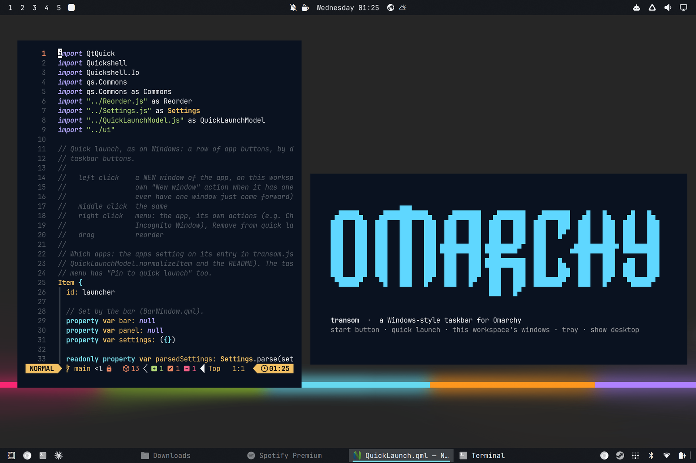
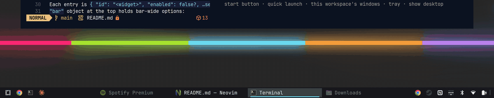
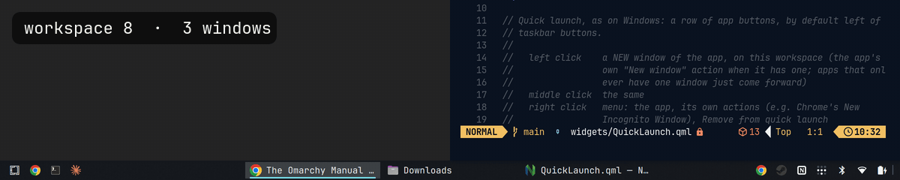
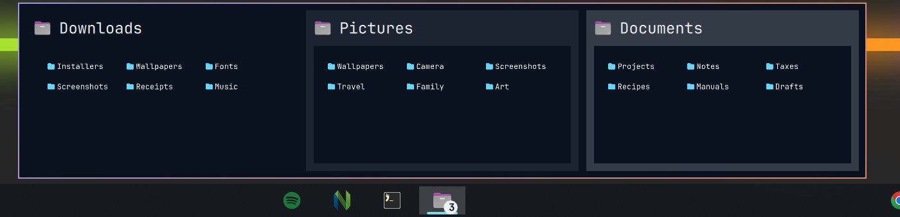
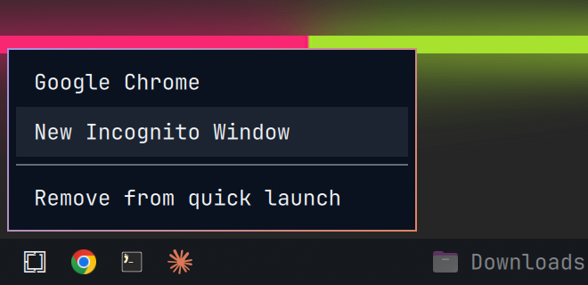
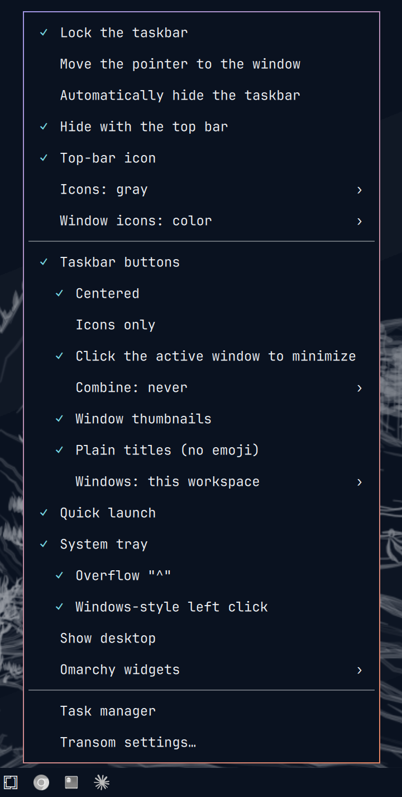
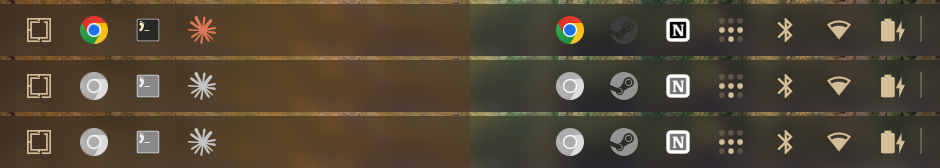

<h1 align="center">
  <picture>
    <source media="(prefers-color-scheme: dark)" srcset="branding/crossbar/lockup-dark.svg">
    
  </picture>
</h1>

**A Windows-style taskbar for [Omarchy](https://omarchy.org):** start button,
quick launch, this workspace's windows, tray, show desktop.



A second bar along the bottom of every screen, for people who think in
taskbars. It's as tall as Omarchy's top bar and dresses like it: theme
colors, font, and the clear, glassy or opaque background you picked for the
top bar. Change the theme and it follows. (A transom is the horizontal bar
across a window. This one sits across all of yours.)



## What you get

- **Workspace aware.** The taskbar shows the windows on the workspace
  you're looking at, so each workspace gets its own taskbar: switch
  workspaces and the buttons switch with you. Prefer the whole screen, or
  every window everywhere? One click in the bar menu ("Windows: this
  workspace / this screen / all"). Windows you minimize stay with the
  workspace they came from.

  

- **Taskbar buttons for those windows,** in the order you drag them into.
  - Click to focus, middle-click to close, scroll to step through windows.
  - Windows minimized with Super+M stay on their workspace's taskbar,
    dimmed, until you click them back (from a screen without a bar, on the
    bars there are: a minimized window always has a button somewhere).
  - Right-click for New window, Pin to quick launch, Minimize, Move to
    workspace, Float/Tile, and Close.
  - Optional: *combine buttons* (never, when full, always) and live *window
    thumbnails*.

  

- **A start button and quick launch.** Omarchy's own menu button, plus your
  apps. A click always opens a *new* window on this workspace. Right-click
  shows the app's own actions (Chrome's New Incognito Window). Pin apps
  from any window's button.

  

- **A system tray that behaves like Windows'.** Click an icon and the app's
  window comes forward, or the app starts, even for apps that ignore tray
  clicks. Overflow "^", pinned and hidden icons, the apps' own menus, drag
  to reorder.
- **Omarchy's own widgets, unchanged:** network, Bluetooth, battery,
  Tailscale and most others (not Media or Indicators), with their real
  panels. Drag them anywhere along the bar.
- **Show desktop** in the corner, Windows-style.
- **A right-click bar menu** for everything that matters, so you rarely need
  the settings file: lock the taskbar, auto-hide, icon style, combine,
  thumbnails, widgets on/off.

  

- **Icons in the theme's color, if you like.** Tray and quick launch icons
  (and, if you want, the window buttons, all but the focused one) drawn in
  the theme's accent color, or in gray, or in the text color to match
  Omarchy's own widgets.

  

- **An optional icon on Omarchy's top bar** to show or hide the taskbar
  (middle-click it) and reach its main settings. See "Top-bar widget".
- **And:** auto-hide that gives windows the space back, emoji-free window
  titles, one bar per screen (or just the primary), and every option in one
  JSON file.

## Install

Transom is an Omarchy shell plugin (a service with its own bar, and an
optional widget for the top bar).

```bash
omarchy plugin add https://github.com/cwilliams5/omarchy-transom.git --enable
```

It's also listed in the Omarchy plugin marketplace:
[omarchyplugins.com](https://omarchyplugins.com/plugin.html?id=io.github.cwilliams5.transom).

`--enable` also puts Transom's icon on Omarchy's top bar (it asks where).
To get rid of it, switch it off rather than removing it: see "Top-bar
widget".

Then, optionally:

- **Put Omarchy's widgets on it:** right-click the bar, "Omarchy widgets",
  tick the ones you want, and take them off the top bar (drag them off, or
  remove them from `bar.layout` in `~/.config/omarchy/shell.json`).
- **Add a start button:** tick "Omarchy menu" on the same page.
- **Make Super+M minimize on every workspace** (Omarchy's only minimizes on
  floating ones), in your Hyprland config:

  ```lua
  o.rebind("SUPER + M", "Minimize window to the taskbar",
    os.getenv("HOME") .. "/.config/omarchy/plugins/io.github.cwilliams5.transom/minimize")
  ```
- **Turn off Omarchy's dock**, which the taskbar replaces:
  `omarchy plugin disable omarchy.dock`.

The out-of-the-box bar is deliberately plain: the taskbar buttons in the
middle; the tray and show desktop on the right. Everything else is opt-in.

**Tested with** Omarchy 4.5.0-3, Hyprland 0.56.2 and Quickshell 0.3.2, on one
2x-scaled laptop screen and a virtual second monitor.

**Dependencies:** none beyond Omarchy. Everything Transom runs ships with
it: Hyprland (`hyprctl`), `jq`, `busctl`, `ps`, `timeout`, `notify-send`,
`uwsm-app`, `gtk-launch`, `xdg-terminal-exec` and Omarchy's own commands. Only for development:
Python 3 for the test tools in `dev/`, and Qt's shader compiler
(`qt6-shadertools`) to rebuild the icon tint shader.

**What it changes:** only its own settings file,
`~/.config/omarchy/transom.json`. It never edits Omarchy's config itself
(one click asks Omarchy to put its top-bar widget back; see "Top-bar
widget"); moving widgets off the top bar or turning off the dock is up to
you.

## Uninstall

```bash
omarchy plugin remove io.github.cwilliams5.transom
```

Then, if you want everything back as it was:

- Delete your settings: `rm ~/.config/omarchy/transom.json`.
- If `~/.config/omarchy/shell.json` still lists `io.github.cwilliams5.transom`
  under `plugins` (installs from before the top-bar widget can keep it),
  delete that entry. Left there it does nothing.
- Remove the Super+M line from your Hyprland config, if you added it
  (Omarchy's own Super+M comes back).
- Put Omarchy's widgets back on the top bar (drag them in, or add them to
  `bar.layout` in `~/.config/omarchy/shell.json`), and turn the dock back
  on if you turned it off: `omarchy plugin enable omarchy.dock`.

## Known limits

- **Hyprland 0.56.2 stacking bug:** a floating window can stay drawn over a
  focused *maximized* window. The bar works around it when it brings a
  maximized window forward (`maximizedRaiseWorkaround`, on by default).
- **Single-window apps** (Spotify, Steam, Notion) just come forward from
  quick launch; there's no second window to open.
- **The start button's menu** opens in the middle of the screen, as
  Omarchy's menu always does.
- **Omarchy widgets on two bars** (two screens, or top and bottom): their
  keyboard shortcuts open the first copy's panel.
- **Omarchy's bar at the bottom:** Transom always takes the bottom edge, so
  with Omarchy's "Bottom Bar" setting the two bars stack there.
- English only, for now.

---

The rest of this page is the reference: every setting, how each part works,
and notes for changing it.

## Settings: where they live, how to change them

**`~/.config/omarchy/transom.json`** says which widgets sit in which
section, and each widget's settings. Until it exists, the plugin's
`defaults.json` is used. Three ways to change it, all applied live:

- **Right-click empty bar space** for the bar menu (below).
- **Right-click a tray icon** for Pin/Unpin and Hide.
- **Edit the file** (the bar menu's "Transom settings…" opens it), or from a
  terminal: `omarchy-shell transom set <widget> '<json>'`, for example
  `omarchy-shell transom set tray '{"maxIcons": 3}'`. `null` removes a
  setting.

Each entry is `{ "id": "<widget>", "enabled": false?, …settings }`. The
`"bar"` object at the top holds bar-wide options:

| Option | Default | What |
|---|---|---|
| `visible` | `true` | Show the taskbar. `false` hides it on every screen and gives windows the space back, but only while Transom's top-bar icon is on the bar (its switch is the way back). See "Top-bar widget". |
| `topBarIcon` | `true` | Show the top-bar widget's icon. `false` leaves the widget on the bar taking no room, so Transom keeps running. Never together with a hidden taskbar: hiding the icon shows the taskbar. |
| `locked` | `false` | "Lock the taskbar": nothing on the bar can be dragged (widgets, tray icons, window buttons). |
| `iconStyle` | `"color"` | App icons (the tray and quick launch): `"color"` as they are, `"mono"` in grays, `"themed"` in shades of a theme color (`iconTint`), so they change with the theme. See "Icon styles". |
| `windowIconStyle` | `"color"` | Window icons (the taskbar buttons), the same three styles. The focused window's button keeps its color unless `iconStyleOn.activeWindow`. |
| `iconTint` | `"accent"` | The color `"themed"` uses: the theme's `"accent"` (changes most visibly from theme to theme) or its bar `"text"` color (matches Omarchy's widget glyphs exactly) |
| `iconStyleOn` | `{ "tray": true, "quickLaunch": true, "inactiveWindows": false, "activeWindow": false }` | `false` keeps the tray or quick launch in color on its own; `activeWindow: true` restyles the focused window's button too. `inactiveWindows` is the 0.1.0 way to style window buttons (see "Icon styles"). |
| `autohide` | `false` | Windows' "Automatically hide the taskbar". See "Auto-hide". |
| `autohideDelay` | `600` | ms after the pointer leaves before it hides (0-10000) |
| `reveal` | `"instant"` | How it comes and goes: `"instant"` or `"slide"` (a 150ms slide) |
| `screens` | `"all"` | Which screens get a bar: `"all"`, `"primary"` (Hyprland's first monitor), or monitor names like `["eDP-1", "DP-2"]` (`hyprctl monitors` lists them). Names that match nothing connected fall back to all. |
| `iconStyleExceptions` | `[]` | Names whose icons stay in color, e.g. `["spotify"]` (any part of the app id or name, any case) |
| `maximizedRaiseWorkaround` | `true` | Works around a Hyprland 0.56.2 bug when bringing a maximized window forward (see "Maximized windows and stacking"). Temporary: turn off and remove once Hyprland fixes it. |

`"enabled": false` keeps a widget's settings but takes it off the bar. Leave a
setting out to get its default. A bad value is ignored, and the shell log says
why (the diagnostics commands list them too).

The file is outside the plugin folder on purpose. Omarchy reloads the whole
plugin whenever anything in its folder changes, and an update of the plugin
shouldn't touch anyone's settings.

## Bar menu

Right-click any empty part of the bar, including the sides of the taskbar:

| Row | Does |
|---|---|
| Lock the taskbar ✓ | The bar option `locked`: no dragging anything |
| Show on all displays ✓ | The bar option `screens`: all, or the primary only (shown with more than one screen) |
| Automatically hide the taskbar ✓ | The bar option `autohide` |
| Top-bar icon ✓ | The bar option `topBarIcon`: brings a hidden icon back, and puts the widget back on Omarchy's bar if it was dragged off |
| Icons: … | Cycles `iconStyle` (the tray and quick launch): color → gray → theme color |
| Window icons: … | Cycles `windowIconStyle` (the taskbar buttons) the same way |
| Taskbar buttons ✓ | Show or hide the window buttons (`tasks`) |
| ⤷ Centered, Icons only | Its `align` and `labels` |
| ⤷ Combine: … | Cycles `combine`: never → when full → always |
| ⤷ Window thumbnails | Its `thumbnails` |
| ⤷ Plain titles (no emoji) | Its `titleSymbols` |
| ⤷ Windows: … | Cycles `windows`: this workspace → this screen → all |
| Quick launch ✓ | Show or hide quick launch (the first time, it starts with your browser and terminal) |
| System tray ✓ | Show or hide the tray |
| ⤷ Overflow "^" | Its `overflow` |
| ⤷ Windows-style left click | Its `replaceLeftClick` |
| ⤷ Show hidden: *name* | One per hidden icon; brings it back |
| Show desktop ✓ | Show or hide the show-desktop button |
| Omarchy widgets › | A page listing Omarchy's own bar widgets: ✓ puts it on this bar. "· top bar" marks the ones also on Omarchy's bar. |
| Task manager | Omarchy's Activity (btop), as Super+Shift+T |
| Transom settings… | Opens `transom.json` in the editor |

Toggles keep the menu open, except "Show on all displays" (it can remove
the bar the menu is on); the last two rows close it.

While `transom.json` has a problem (invalid JSON, a section that isn't a
list, an entry without an `id`), a first row says so and opens the file:
nothing is saved over a file Transom couldn't fully read, so your edits
are safe. A notification says what's wrong, once.

## Top-bar widget (optional)

Transom's icon on Omarchy's top bar: the Transom window, with the taskbar
as its bottom rail (left out while the taskbar is hidden).

| Click | Does |
|---|---|
| Left or right | A dropdown with nearly everything the bar menu has. **Show the taskbar** across the top, then two columns. Bar: auto-hide, lock, all displays (with more than one screen), and **Top-bar icon** (this icon). Taskbar buttons (on/off): icons only, combine, thumbnails, plain titles, which windows. System tray (on/off): overflow, how many icons before "^" (a slider), Windows-style left click. Quick launch (on/off). Icons: the style for the tray and quick launch, for window buttons, whether the focused window stays in color, and which theme color. Buttons open the bar menu (for Omarchy's widgets and hidden tray icons) and the settings file. A section switched off hides its rows. Keyboard: j/k or the arrows, h/l on the slider, Enter. |
| Middle | Show or hide the taskbar |

**Hiding the taskbar** (the bar option `visible`) takes it off every
screen, and windows get the space back. It only works while the icon is on
the top bar, since its switch is how you get the taskbar back: take the
widget off the bar, or hide its icon, and the taskbar comes back by itself.
Nothing is written then: when the widget is back, the taskbar is hidden
again as you left it. If the widget
doesn't show up within 10 seconds of the shell starting, the taskbar shows
anyway. From a terminal or a key binding:
`omarchy-shell transom show`, `hide` or `toggle` (and `omarchy-shell
transom widget` says what Transom knows about its widget). For example, in your
Hyprland config (pick any free keys):

```lua
o.bind("SUPER + ALT + T", "Show or hide the taskbar", "omarchy-shell transom toggle")
```

**Don't want the icon? Switch it off rather than removing it:** the
dropdown's **Top-bar icon** switch (the bar option `topBarIcon`). The
widget then takes no room on the top bar and Transom keeps running; the
bottom bar's right-click menu has **Top-bar icon** to bring it back. That
row also puts the widget back on Omarchy's bar if it was dragged off
(through Omarchy's own command, the one change to Omarchy's config
Transom ever asks for, and only on that click).

Why not remove it: Omarchy runs a plugin that has a top-bar widget only
while that widget is on a bar, unless the plugin is also in the `plugins`
list of `~/.config/omarchy/shell.json`. `omarchy plugin add --enable` puts
it on the bar and not in that list, so removing the widget turns Transom
off, taskbar and all. The dropdown says so under the switch when that's
the case on your computer. (Installs from before Transom had a widget are
in the list; for those, removing it changes nothing.)

**Omarchy's plugin list** (`omarchy plugin list`, and plugin managers built
on it) calls a plugin with a widget enabled only while the widget is on the
bar, so it can call Transom disabled while the taskbar runs. Its
enable/disable then puts the icon on the bar or takes it off.

## Taskbar buttons (`tasks`)

One button per window on the screen's current workspace, in the order they
opened, plus the windows **minimized from** that workspace (dimmed). A window
minimized on workspace 1 shows on workspace 1's taskbar only.

| Action | Result |
|---|---|
| Left click | Focus the window, or bring a minimized one back. Clicking the window that's already active does nothing (or minimizes it: `activeClick`). |
| Middle click | Close it |
| Right click | Menu: New window, Pin to quick launch, Minimize/Restore, Move to workspace 1–5, Float/Tile, Close |
| Scroll | Step to the next or previous window (minimized ones are skipped) |
| Drag | Reorder. The order lasts until the shell restarts; new windows go last. |
| Hover | Full title in a tooltip, when it's cut off or hidden |
| Super+M | Minimize the active window, on any workspace (with the Super+M line from Install, which runs `./minimize`) |

A window tagged `skip-taskbar` gets no button unless it's minimized (so it
can still be brought back). Hyprland has no "skip taskbar" flag of its own;
Legato tags its picture-in-picture video window this way while it's set to
Always on top, and a rule of your own can tag any app, in your Hyprland
config:

```lua
o.window("^my-overlay-app$", { tag = "+skip-taskbar" })
```

Buttons are about 180px with icon and title. They shrink evenly when they
don't all fit, then go icon-only. Titles are cut off with "…" and never
scroll. The row is centered on the screen. Windows asking for attention get
a steady tint, never a flash. Thumbnail previews are off unless you turn
them on (`thumbnails`).
The bar hides under a real fullscreen window and when the top bar is hidden.

### Tasks settings

On the `tasks` entry. The spec is `SETTINGS` in `TasksModel.js`, checked
by `Settings.js`.

| Setting | Default | Options |
|---|---|---|
| `align` | `"center"` | `"center"` (on the screen, like Windows 11), `"left"` (like Windows 10) |
| `labels` | `"title"` | `"title"` (icon + title), `"icon"` (always icon-only) |
| `buttonWidth` | `180` | Button width in px before shrinking to fit (40–600) |
| `minTextWidth` | `90` | Narrower than this, buttons go icon-only (0–600) |
| `windows` | `"workspace"` | `"workspace"`: this workspace's windows plus those minimized from it. `"monitor"`: every workspace on this screen. `"all"`: every window. |
| `minimized` | `"dimmed"` | `"dimmed"`, `"normal"`, `"hidden"` |
| `activeClick` | `"nothing"` | Clicking the active window: `"nothing"`, `"minimize"` (the Windows default) |
| `middleClick` | `"close"` | `"close"`, `"nothing"` |
| `tooltip` | `true` | Full title on hover, when it's cut off or hidden |
| `tooltipDelay` | `600` | ms of hovering before the tooltip shows (0–5000) |
| `scroll` | `true` | Scroll over the taskbar to step through windows |
| `reorder` | `true` | Drag buttons to reorder |
| `urgentTint` | `true` | Steady tint on windows asking for attention |
| `workspaces` | `5` | Workspaces in the menu's "Move to" (1–10) |
| `combine` | `"never"` | Windows' "combine taskbar buttons": `"never"` (one button per window), `"full"` (one per app once the windows' own buttons would be squeezed to icons), `"always"` (one per app, icons only, as on Windows 11). See "Combined buttons". |
| `thumbnails` | `false` | Hovering a window's button shows a live picture of the window instead of the title tooltip; a combined button's list becomes a strip of them. See "Thumbnails". |
| `titleSymbols` | `"keep"` | `"strip"` drops emoji and symbols from titles: "✳ Claude Code" shows as "Claude Code". It also stops animated titles (Claude Code's spinner) from moving. Letters, digits, punctuation and arrows stay. |

Example: left-aligned, icon-only, every window on the screen:

```json
{ "id": "tasks", "align": "left", "labels": "icon", "windows": "monitor" }
```

### Combined buttons

With `combine` on, an app's windows share one button: the app's icon with a
small window count, and its name as the label unless combining "always"
(icons only). The button sits where the app's first window would be.

| Do | What happens |
|---|---|
| Left click | A list of its windows: the active one ticked, minimized ones dimmed. Pick one to bring it forward (or back). |
| Middle click | A new window of the app |
| Right click | New window, Pin to quick launch, Close all windows |
| Drag | Moves the app's windows together |

An app with one window keeps a plain window button (with "always" it's
icon-only). Apps are told apart by desktop entry: every Chrome window is one
app, but each web app is its own, as on the taskbar anyway. Coding-agent
windows group as the agent.

### Thumbnails

Off by default: plenty of people turn them off on Windows too (visual noise). With
`thumbnails` on, hovering a window's button for `tooltipDelay` ms shows its
title and a live picture of the window, and a combined button's click shows
a strip of them, Windows-style: click one to bring it forward. Minimized
windows still have a picture (Hyprland keeps their last frame); a window that
gives none shows "No preview". Windows hidden from screen capture on purpose
(Omarchy marks password managers like Bitwarden and 1Password
`no_screen_share`) are never captured: their thumbnail is the app's icon and
"Hidden from screen capture". If Hyprland gives no clear answer about a
window, it isn't captured either ("No preview"). Pictures are captured only
while a thumbnail is on its way or shown (Quickshell's `ScreencopyView`,
`ui/WindowPreview.qml`).

## Quick launch (`quicklaunch`)

App buttons, Windows-style, by default left of the taskbar buttons. A click
always opens a **new window** of the app on the current workspace: the app's
own "New window" action when its desktop entry has one (Chrome, Firefox, VS
Code...), otherwise the app is started again. Apps that only ever have one
window (Spotify, Steam, Notion) just come forward.

| Do | What happens |
|---|---|
| Left or middle click | A new window |
| Right click | A menu: the app (a new window), the app's own actions (e.g. Chrome's "New Incognito Window"), Remove from quick launch |
| Drag | Reorder (`reorder`, off while the taskbar is locked) |
| Hover | The app's name |

**Pin to quick launch:** right-click any window's taskbar button. It adds the
app (and puts quick launch on the bar if it isn't there); "Unpin from quick
launch" takes it off.

### Quick launch settings

| Setting | Default | What |
|---|---|---|
| `apps` | `[]` | The buttons, in order (below) |
| `iconSize` | `16` | Icon size in px (8-32). 14 matches a tray set to 14. |
| `tooltip` | `true` | The app's name on hover |
| `tooltipDelay` | `600` | ms before it shows |
| `reorder` | `true` | Drag to reorder |

Each element of `apps` is one of:

- **An app:** its desktop entry id, e.g. `"google-chrome"`,
  `"org.gnome.Nautilus"`, `"code"` (case and `.desktop` don't matter much;
  a close name like `"chrome"` is looked up too).
- **Omarchy's launchers:** `"terminal"` (your default terminal, as
  Super+Enter: in the folder of the terminal you're in, else your home
  folder), `"browser"` (your default browser),
  `"agent"` (your default coding agent, as `omarchy agent`, with its logo).
- **An app with arguments:** `{ "app": "google-chrome", "args": ["--incognito"], "name": "Incognito" }`.
- **Any command:** `{ "command": "omarchy-launch-tui btop", "name": "Activity", "icon": "utilities-system-monitor" }`.
  `icon` is a theme icon name or a path.

For example: `{ "id": "quicklaunch", "apps": ["google-chrome", "terminal", "agent"] }`.

## System tray

The icons apps show while running in the background, like Steam, Discord,
Notion, or Chrome with "continue running background apps" on. Apps publish
them over StatusNotifierItem, Linux's notification area, which Quickshell's
`SystemTray` reads. It's the same list Omarchy's top-bar tray shows; only one
of the two should be on screen: take `omarchy.tray` off the top bar
(`omarchy plugin disable omarchy.tray`; `enable` brings it back).

| Action | Result |
|---|---|
| Left click | The app's own action first. If nothing happens, Windows-style: bring its window forward (restoring it if minimized), else start it from its launcher (a running single-instance app then shows its window), else open its menu. See below. |
| Middle click | The app's secondary action |
| Right click | The app's menu, drawn in the theme's style, with submenus opening in place behind a back row. Below it: **Pin to bar** / **Unpin from bar**, and **Hide this icon**. Icons without a menu get just those two. |
| Drag | Reorder the icons on the bar (saved as `order`). It doesn't pin them. Apps that aren't running keep their place in the order. Icons in the flyout don't drag. |
| Scroll | Passed to the app (some use it) |
| "^" | Flyout with the icons that didn't fit |

**Left click, in detail.** Each app decides what a click on its icon does.
Some do something real: Discord toggles its window, Flameshot takes a
screenshot, a network applet pops up. Others do nothing at all: Chrome and
Notion take the click and ignore it. Steam's AppIndicator icon is only a
menu. So:

1. The click goes to the app. An icon that says it's only a menu
   (`ItemIsMenu`) opens its menu instead, which is the app's own answer.
2. `replaceLeftClickWaitMs` (300) later, the tray looks again. If any of the
   app's windows appeared, disappeared or took focus, the app handled it,
   and that's that. (So Discord's click-to-hide still works.)
3. Otherwise it steps in: bring the app's window forward; if it has none,
   start it from its launcher; if there's no launcher, open its menu.

`replaceLeftClick: false` turns steps 2 and 3 off everywhere. `nativeClick`
turns them off for the listed apps, for one whose own click does something
invisible (toggling a VPN, say), where stepping in would be a second action.

The tray can't tell which app owns an icon (Quickshell's tray items carry no
process id). So `./tray-window <icon id> <name>` asks D-Bus for the icon's
process and lists that process's windows, children included. The window it
picks to bring forward is never a Chromium web app's: Chrome and its web apps
are one process, but each web app is its own app with its own taskbar
button. A window whose class contains the icon's name comes first (`chrome`
finds `google-chrome`), then the most recently used. With only web apps open,
Chrome counts as having no window, so the click starts it. Run the script by
hand to see what a click would do. To pick the "before" view, the tray runs
it when the pointer reaches the icon, so the app's own click isn't delayed.

Icons an Omarchy widget already shows are left out automatically, as on the
top bar. Superwhisper's icon is left out while its widget is on either bar.

### Tray settings

| Setting | Default | Options |
|---|---|---|
| `overflow` | `true` | `false` shows every icon on the bar |
| `maxIcons` | `6` | Icons on the bar before the rest go behind "^" (0–50). Pinned icons don't count against it. |
| `pinned` | `[]` | Names never put in the overflow, even past `maxIcons`. Set from the icon's menu. |
| `reorder` | `true` | Drag icons on the bar to reorder them. |
| `order` | `[]` | Names in the order the icons sit, set by dragging. Icons it doesn't name yet follow: pinned ones, then the rest in the order they appeared. The unpinned icons last in the order overflow first. |
| `hidden` | `[]` | Names never shown |
| `tooltip` | `true` | The app's name on hover |
| `tooltipDelay` | `600` | ms of hovering before it shows (0–5000) |
| `iconSize` | `16` | Tray icon size in px (8–32). Omarchy's own tray and widget glyphs are 12. Every icon sits on the same 27px grid either way. |
| `replaceLeftClick` | `true` | Step in when an app ignores a left click (see above) |
| `replaceLeftClickWaitMs` | `300` | ms the app gets before the tray steps in (0–5000) |
| `nativeClick` | `[]` | Names whose left click only ever goes to the app |
| `restoreTo` | `"origin"` | Where a click brings back an app's minimized window: `"origin"`, the workspace it was minimized from (the screen switches there), or `"current"`, this one |

**Names** match any part of an icon's id, title or tooltip, ignoring case,
so `"steam"` matches Steam's icon. Apps name their icons loosely: Notion's id
went from `Notion_status_icon_6` to `_7` between launches, so the short name
is what sticks. To see every icon with its name and where it goes:

```bash
omarchy-shell transom tray
```

Example: Steam and Discord always visible, at most 3 icons, Chrome's hidden:

```json
{ "id": "tray", "maxIcons": 3, "pinned": ["steam", "discord"], "hidden": ["chrome"] }
```

## Show desktop

A thin button in the bar's corner, as on Windows: a click minimizes every
window on the workspace; the next click brings those back, and the one that
was active last gets focus. If anything was opened or brought back in
between, the click minimizes everything again. The minimized windows are
ordinary ones: they're on the taskbar, dimmed. Entry
`{ "id": "showdesktop" }`; settings `width` (px, default 10) and `tooltip`.
It's last in the right section, flush with the corner.

## Start button

Omarchy's own menu button (`omarchy.menu`, the Omarchy logo) makes a
Windows-style start button: put `{ "id": "omarchy.menu" }` first in the left
section, or tick "Omarchy menu" on the bar menu's "Omarchy widgets" page (it
lands on the right; drag it to the left). Take it off the top bar's
`bar.layout.left` in `shell.json` if it shouldn't be in both places.

- **Left click:** Omarchy's menu (Apps, Learn, Appearance...), the same one
  as Super+Alt+Space. It opens in the middle of the screen, as Omarchy's menu
  always does; it has no option to open from a corner.
- **Right click:** a new terminal (Omarchy's choice for this button).

## Several screens

Every screen gets its own bar (or just some: the `screens` option), each with
the same layout. Each screen's taskbar buttons show that screen's workspace
(`windows`: "this workspace" or "this screen"; "all" shows everything
everywhere), show desktop and the tray's restore act on that screen's
workspace, and menus and Omarchy's panels open on the screen that was
clicked.

A screen without a bar (`screens` set to `"primary"` or a list, or "Show on
all displays" off) has its windows shown on the bars there are, as Windows
does with the taskbar on the main display only: the workspace it's showing
("this workspace"), or all its workspaces ("this screen"). A window
minimized there keeps its button too, even after Hyprland drops the empty
workspace.

Tested 2026-11-18 with a virtual second monitor
(`hyprctl output create headless`): a second bar, a window on it shown only
on its taskbar, the bar menu and the battery panel opening there, and
`screens` all/primary/by name. Omarchy's panels for a widget on both bars
log "handler was registered but will not be used" once: the first copy owns
the panel's command, as with the top bar.

## Auto-hide

With `autohide` on, the bar hides and gives its space back: tiled and
maximized windows reach the bottom edge. Push the pointer to the bottom
edge and it comes up *over* the windows, without resizing them. It goes
again `autohideDelay` ms after the pointer leaves. It never hides while
one of its menus or panels is open (the bar menu, a tray menu, the network
panel...) or while something is being dragged.

How: the bar's window stays mapped, but reserves no space
(`ExclusionMode.Ignore`). Hidden, its content sits below the screen edge and
only a 2px strip along the edge takes input (the window's input mask), so
clicks everywhere else reach the windows. Each widget tells the bar whether
one of its popups is open (`popupVisible`, read through `Service.popupOpen`).

## Icon styles

Two sets of icons, each with its own style, from the bar menu ("Icons" and
"Window icons") or the top-bar widget's dropdown:

- **App icons** (the tray and quick launch): the bar option `iconStyle`.
- **Window icons** (the taskbar buttons): the bar option `windowIconStyle`.
  The focused window's button keeps its color so it stands out, unless
  `iconStyleOn.activeWindow` is on ("Focused window in color" in the
  dropdown).

Each is `"color"` (as they are), `"mono"` or `"themed"`. Omarchy's own
widgets are already one color.

- `"mono"`: grays.
- `"themed"`: shades of one theme color, picked by `iconTint`. The default,
  `"accent"`, is the theme's accent (blue on Tokyo Night, orange on Matte
  Black, pink on Hardlight...), so icons change visibly with the theme.
  `"text"` uses the bar's text color: the same color as Omarchy's widget
  glyphs, for a quiet, all-matching bar.
- **Leaving some out:** `iconStyleOn` keeps the tray (`"tray": false`) or
  quick launch (`"quickLaunch": false`) in color on its own, and
  `"activeWindow": true` restyles the focused window's button too. Its
  `inactiveWindows` is how Transom 0.1.0 styled window buttons (with
  `iconStyle`); it still works while `windowIconStyle` is `"color"`, and
  picking a window style from a menu turns it off.
- `iconStyleExceptions` keeps chosen apps in color everywhere.

How: `shaders/tint.frag` turns each pixel's brightness into a shade of the
color, from about 60% to 120% of it on a dark bar (darker shades on a light
one), so dark icons such as Steam's stay visible and busy ones keep their
detail. It's compiled to `tint.frag.qsb` (Qt's `qsb`, package
`qt6-shadertools`, only needed to change the shader).

Symbolic icons (made to be recolored) are always painted in the text color,
whatever the style. Coding-agent windows (`org.omarchy.agent`, from
`omarchy agent`) show the default agent's logo instead of a terminal icon.

## Moving widgets

Drag one of Omarchy's widgets (network, battery, the start button...) along
the bar to move it: within its side, or across to the other side. The others
step aside to show where it will land; let go to drop it. A short press is
still a click. Show desktop stays in the corner. Transom's own tray, taskbar
buttons and quick launch don't move this way, since dragging inside them
reorders their icons; change their place in the settings file. "Lock the
taskbar" turns all dragging off.

The drop saves the layout. Saving keeps every widget alive (each section is a
model keyed by widget id), so only the moved one changes place.

## Omarchy's own widgets (network, power, bluetooth…)

Any of Omarchy's own bar widgets can sit on the bottom bar, unchanged. Tick
it on the bar menu's "Omarchy widgets" page, or add its id to a section,
e.g. `{ "id": "omarchy.network" }` after the tray. Other plugins' widgets
aren't offered: on this bar they get Transom's access to the shell, not
their own, so most can't reach their plugin. Neither are Omarchy's Media
and Indicators widgets: they read services Omarchy gives only to its own
bar, so on this one Media never appears and most indicators never light. (Typed into the file, one
still loads, which suits those that find their plugin another way.)
Transom's own top-bar widget is never hosted here: it would hide along
with the taskbar it brings back. Ids are the
same as the top bar's (`omarchy plugin list`). It's the same widget code Omarchy's
top bar runs, with its real panel, which opens upward.

- **How:** `widgets/OmarchyWidget.qml` loads the widget from Omarchy's widget
  catalogue (the `barWidgetRegistry` the plugin host hands this service). It
  gives the widget `ui/OmarchyBarApi.qml` as its `bar`, mirroring Omarchy's
  `PluginBarApi` (its interface for widgets on other bars) plus a few extras.
  No widget is rebuilt.
- **Panel buttons that open other panels** (the network panel's Wi-Fi QR and
  speed test) go through `omarchy-shell shell summon`, because this plugin's
  own shell access can't open them. **Options a widget saves** (the power
  widget's battery percentage) are saved on its entry here.
- **Moving one off the top bar:** drag it off Omarchy's bar, or delete its
  entry from `bar.layout` in `~/.config/omarchy/shell.json`. **Don't** use
  `omarchy plugin disable` for a widget wanted here. Omarchy's built-in
  widgets stay in the catalogue while they're merely off its bar, but a
  disabled plugin may not. Options set on the top bar's entry (e.g. the
  power widget's `showPercentage`) move to this bar's entry by hand.
- **Keyboard shortcuts and menu items that open a widget's panel** open the top
  bar's copy while the widget is on both bars (the first copy registers the
  command). Remove it from the top bar to make the bottom one the target.
- **Tooltips:** a widget's own tooltip text shows, as on the top bar. A
  widget that gives none gets no tooltip, not an empty bubble.
- **If an Omarchy update breaks one:** compare `ui/OmarchyBarApi.qml` with
  `/usr/share/omarchy/shell/Ui/PluginBarApi.qml`, and with what the widget
  reads from `bar.`, in its folder under `/usr/share/omarchy/shell/plugins/`.
  Tested 2026-11-17 on Omarchy 4.5.0-3 with `omarchy.network`.

## Files

| File | What |
|---|---|
| `manifest.json` | Plugin id `io.github.cwilliams5.transom`, kinds `service` and `bar-widget`. Runs while its id is in `plugins` or its widget is in `bar.layout`, in `~/.config/omarchy/shell.json`. |
| `Service.qml` | Reads the look and the layout, saves settings (`updateWidget`), runs Hyprland commands and app launches for the widgets, the one-popup-at-a-time rule, the diagnostics commands. Opens a `BarWindow` per screen. Also the list of widget ids (`widgets`). |
| `BarWindow.qml` | One screen's bar: background, the three sections, loading widgets into them, the right-click on empty space. |
| `BarMenu.qml` | The bar's right-click menu. |
| `BarWidget.qml`, `TopBarWidget.js`, `Registry.js` | The optional top-bar widget: its icon and dropdown; when the taskbar may be hidden and the dropdown's choices; how the widget finds the service on a bar that isn't Omarchy's. |
| `IconStyle.js` | Which style each app icon gets (`iconStyle`, `windowIconStyle`, `iconStyleOn`, exceptions). |
| `ui/CrossbarIcon.qml` | The Transom mark, drawn for the top-bar widget. |
| `defaults.json` | The layout and settings used until `~/.config/omarchy/transom.json` exists. |
| `widgets/Tasks.qml` | The taskbar buttons (`tasks`) and their right-click menu. |
| `widgets/QuickLaunch.qml`, `QuickLaunchModel.js` | Quick launch: buttons, launching, its menu; the model parses `apps` and does pinning. |
| `ui/AppIcon.qml` | An app icon that falls back through candidate images, in the bar's icon style. |
| `shaders/tint.frag` (`.qsb`) | The icon tint shader for mono and themed, and its compiled form. |
| `ui/WindowPreview.qml`, `ui/ThumbnailPopup.qml` | A live picture of a window, and the hover thumbnail built on it. |
| `widgets/Tray.qml` | The system tray: icons, "^" flyout, app menus, pin/hide, drag. |
| `widgets/OmarchyWidget.qml`, `ui/OmarchyBarApi.qml` | Hosting Omarchy's own widgets (see above). |
| `widgets/ShowDesktop.qml` | The show-desktop button. |
| `TasksModel.js`, `TrayModel.js` | Each widget's settings spec and pure logic (which windows or icons show, order, sizes, pins). |
| `Settings.js` | Checks a widget's layout entry against its spec. |
| `Reorder.js` | Drag-to-reorder math: the taskbar, tray and quick launch icons, and whole widgets along the bar. |
| `tray-window` | For a tray icon's left click: its app's process and most recent window (see System tray). |
| `ui/AnchoredPopup.qml` | Base of every popup: sits above an item, closes on an outside click. Handles the two popup traps (see Developing). |
| `ui/TooltipPopup.qml`, `ui/MenuCard.qml`, `ui/MenuItemRow.qml` | Tooltip, menu card and menu row in Omarchy's popup style. |
| `Hosting.js` | Which of Omarchy's widgets the bottom bar hosts. |
| `CaptureCache.js`, `Registry.js` | Which windows are hidden from capture, remembered; the service handed to the top-bar widget. |
| `tests/` | `run` runs everything: `run.js` (node, the `.js` files), `scripts.test.sh` (`minimize` and `tray-window` against stand-in commands), `widget.test.sh` (the real top-bar widget and service, offscreen). `mutate.js` plants `mutations.json` one at a time to check the tests catch each. |
| `minimize` | Minimizes a window (the active one, or an address). Omarchy's minimize minus its floating-only check. |
| `dev/` | Test tools: `vclick.py` (click and drag from a script) and `clicklog.py` (a terminal that counts clicks). |
| `media/` | The README's screenshots. |
| `branding/` | The logo (`crossbar/`), the options not picked (`alternatives/`), `BRANDING.md`, and `build.py` to regenerate them all. `icon.svg` at the root is the app icon. |

## Adding a widget

1. Create `widgets/<Name>.qml`, an `Item` with `implicitWidth`/`implicitHeight`.
   It can declare any of these, which the bar fills in:
   - `bar`: the service, for `foreground`, `background`, `urgent`, `fontFamily`, `barSize`, `pluginDir`, `topBarLayout`
   - `panel`: this screen's bar window, for `panel.screen`
   - `settings`: its layout entry. Give the widget a `SETTINGS` spec in a model `.js` file and read it with `Settings.parse(settings, SPEC)`.
   - `screenCenterX`: the screen's center in its own coordinates
   - `fills: true`: take all the width left in the center section
2. Build popups from `ui/` (`import "../ui"`): `AnchoredPopup`, `TooltipPopup`,
   `MenuCard`, `MenuItemRow`. Before opening one, call
   `bar.claimPopup(<the widget>)`, and give the widget a `closePopups()`
   function. That keeps one popup open at a time across the bar, and a click
   on empty bar space closes it.
3. Add its id to `widgets` in `Service.qml`.
4. Put `{ "id": "<id>" }` in a section of `defaults.json` (and your own `transom.json`). To save settings from the widget, call `bar.updateWidget("<id>", { … })`.

Omarchy's own bar widgets (like `omarchy.network`) need none of this: put
their id in a section (see "Omarchy's own widgets").

## How it fits with Omarchy

- **Not a "bar" plugin.** Omarchy's `bar` kind replaces the top bar rather
  than adding one, so this is a `service` that opens its own layer-shell
  windows.
- **Namespace `omarchy-bar`** (the top bar's), on purpose: Hyprland's layer
  rules for the top bar then apply here too. Those are the glassy blur, no
  slide-in animation, and the window-glassy toggle.
- **Minimize protocol:** a minimized window sits on `special:minimized` with
  the tag `omarchy-minimized-from-<workspace id>`. Omarchy's own minimize (the
  titlebar button on floating workspaces) does the same, so the taskbar shows
  windows minimized either way.
- **Omarchy's dock** (`omarchy.dock`) does the same job as the taskbar, so
  turn it off (`omarchy plugin disable omarchy.dock`; `enable` brings it
  back).
- **Popup traps** (both handled in `ui/AnchoredPopup.qml`):
  - Outside clicks close a popup through a `HyprlandFocusGrab`, set up like
    Omarchy's `PopupCard`. The grab arms 50ms after the popup appears, so the
    popup is in its allowed list. Armed too early, every click on a menu
    counted as outside and closed it before the option ran. If menu options
    ever stop responding, check the log for "menu closed by a click outside
    it".
  - A popup keeps its last anchor after it closes. Clearing the anchor while
    it was still on screen moved it to the bar's corner for a frame.
- **Maximized windows and stacking** (bar option `maximizedRaiseWorkaround`,
  temporary): Hyprland 0.56.2 keeps drawing floating windows over a
  maximized window even after the maximized one gets focus. Neither
  `alter_zorder` nor `bring_to_top` changes that, and the windows left on top
  look clickable but aren't. So when the bar brings forward a maximized
  window (`raiseSteps` in `Service.qml`), it un-maximizes it, raises it and
  maximizes it again, with animation off. Reproduced 2026-11-17 with two
  solid-colored `foot` windows on a spare workspace. Omarchy's dock and
  keyboard focus have the same problem. A "maximize" that's really a resize
  (some setups do this on floating workspaces) doesn't hit it, since
  `fullscreen` stays 0. Keep `isMaximized` meaning real maximized
  (`fullscreen == 1`); other windows only need the plain raise. Re-test on
  Hyprland 0.57.2 or later, which may fix it, then turn the option off and
  remove the workaround.
- **App tray menus** are drawn by us. Qt's native menus can't open in
  Omarchy's shell (it isn't started in QApplication mode), as Omarchy's own
  tray notes.
- **Third-party plugin limits:** no access to Omarchy's app library or the
  full shell config, so apps launch with `uwsm-app -- gtk-launch` (as
  Omarchy's launcher does) and the layout lives in its own file, not
  `shell.json`.

## Developing

`CLAUDE.md` has the maintainer's notes: the rules and why they exist, the
platform facts Transom depends on, and how to test it live.

- **Tests:** `tests/run` (about 20 s; nothing appears on screen and nothing
  outside temp folders is touched). `node tests/mutate.js` checks that every
  regression in `tests/mutations.json` fails a test. CLAUDE.md says what each
  suite covers and what none does.
- **Clicking and dragging from a script:** `dev/vclick.py` drives the pointer
  through Wayland's virtual-pointer protocol (Python only).
  - `--click-here` clicks where the pointer is (`--right`, `--middle` for
    other buttons); `--drag DX` presses, moves DX pixels sideways and lets go.
  - On a 2x-scaled screen Hyprland confines a virtual pointer's *absolute*
    moves to the top-left quarter, so place the pointer with
    `hyprctl dispatch 'hl.dsp.cursor.move({ x = X, y = Y })'` first.
    Relative moves (`--drag`) work anywhere.
  - `dev/clicklog.py` runs in a test terminal and counts the clicks it
    receives.
  - Editing anything in the plugin folder, `dev/` included, reloads the
    plugin. Don't do it in the middle of a test.
- **Restart the shell after editing QML:** `omarchy restart shell`. Saving a
  file here triggers Omarchy's plugin reload, but QML files that are already
  loaded stay cached, so the reload runs the old code. (Seen 2026-11-17: the
  log kept pointing at line numbers of the previous version.) The restart
  refuses while the screen is locked.
- **Logs:** `/run/user/$UID/quickshell/by-pid/<shell pid>/log.log`. Get the pid
  with `pgrep -f 'quickshell -n -p /usr/share/omarchy/shell'`. Grep for
  `transom:`.
- **Check the bar exists:**
  `hyprctl layers -j | jq '.. | objects | select(.namespace? == "omarchy-bar")'`
  lists the top bar and this one, which is `h=26` at the bottom.
- **What the taskbar sees:** `omarchy-shell transom windows` prints every
  window with its workspace, tags, the workspace it was minimized from, and
  which screens' taskbars show it. Start here when a window is missing.
- **What the tray sees:** `omarchy-shell transom tray` prints every tray
  icon, its name for `pinned`/`hidden`, and where it goes.
- **Window data:** Quickshell keeps `workspace` and `title` current, but
  `lastIpcObject` (tags, floating, fullscreen) only changes on
  `Hyprland.refreshToplevels()`. `Service.qml` calls that after window
  events.
- **Lists from `lastIpcObject` aren't JS arrays.** `tags` arrives as a Qt
  `V4Sequence`: indexable with a `length`, but `Array.isArray` is false. Use
  `TasksModel.toList()`. (This hid every minimized window in the first
  version.)
- **Dispatch syntax** is Hyprland's Lua API (`hl.dsp.window.move({ … })`).
  Copy forms from `/usr/share/omarchy/default/hypr/` and Omarchy's dock
  (`/usr/share/omarchy/shell/plugins/dock/Dock.qml`).
- **Work in a clone of the repo, not in the installed copy.**
  `omarchy plugin update` only fast-forwards, so a commit made inside
  `~/.config/omarchy/plugins/io.github.cwilliams5.transom` blocks updates.
  To try a branch live, fetch it into the installed copy (CLAUDE.md,
  "Working on it", has the commands). Your settings
  (`~/.config/omarchy/transom.json`) live outside both.

## Not built yet

- Very long tray menus don't scroll yet
- Translations (menus and tooltips are English only)

Decided against: flashing for attention, and a per-window audio indicator
or volume slider. Omarchy's sound menu already has per-app volume, and
Chrome and its web apps share one process, so sound can't be tied to one of
their windows.

## License

MIT. See [LICENSE](LICENSE).
