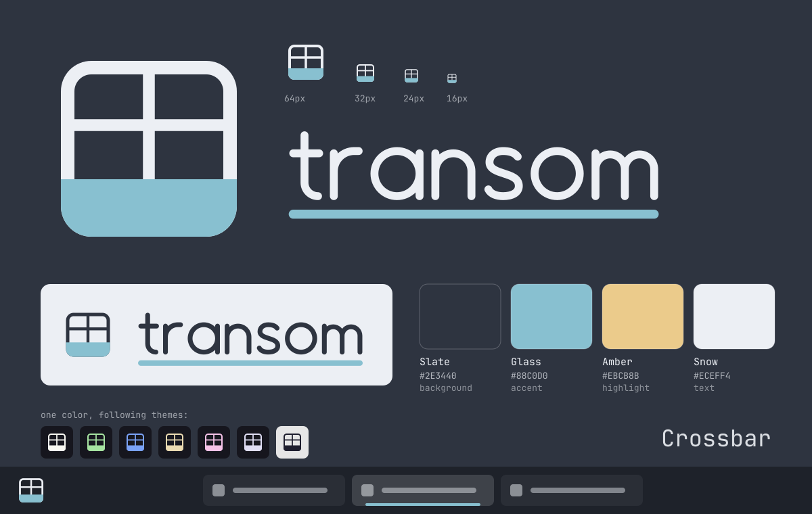
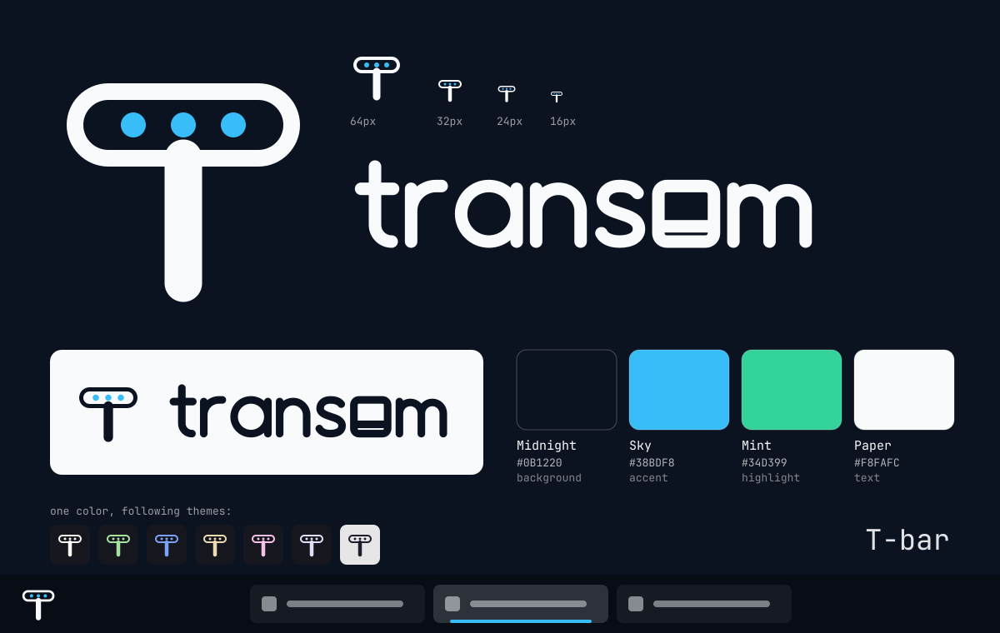

# Transom branding

**Picked (2026-11-18): Crossbar**, in `crossbar/`: a window whose bottom
rail is the bar, a lowercase wordmark sitting on its own bar, and the
slate/glass/amber palette. The README's header uses its lockup, and
`icon.svg` at the repo root is its app tile.

The two options not picked are kept in `alternatives/` for reference.

## The name

A **transom** is the horizontal bar across a window or above a door: the
crosspiece that divides the glass. This is a horizontal bar across the bottom
of your screen, holding your windows. Several more meanings fit too:

- **A bar for Windows people.** It's a Windows-style taskbar, so it's a bar
  across *your windows* in both senses.
- **Arch.** A transom is architecture, and architecture leads to *Arch*, the
  Linux that Omarchy is built on. Many transoms literally hold an arched
  fanlight.
- **A building-trade name.** It sits next to Cody's *Rebar*: both are bars
  from construction, and both hold something up.
- **It ends in "om",** like Omarchy.
- **It's short, pronounceable and unclaimed** in the Omarchy plugin world.

(The nautical transom, the flat back of a boat, is a coincidence; the
branding doesn't use it.)

## Rules for every option

- **One color first.** Every icon and wordmark works in a single color
  (`currentColor` in the SVGs), so it can follow the user's Omarchy theme,
  as the bar does, and matches Transom's own monochrome icon style. The
  accent is optional: `icon-color.svg` and `wordmark-color.svg` show it.
- **16px matters.** The icon is designed to read at the bar's icon size. The
  preview sheets show 64, 32, 24 and 16px.
- **Lowercase in running text:** "Transom" in sentences, the wordmark only as
  a logo.
- **Voice:** plain and practical, Windows terms where they help ("Lock the
  taskbar", "Combine taskbar buttons"). No hype, no emoji.

## Option 1: Crossbar (picked)



- **Icon:** a four-pane window whose bottom rail is a solid bar in the
  accent color. It's a window, and it's a taskbar.
- **Wordmark:** geometric monoline lowercase **transom**, sitting on its own
  bar: the underline is the transom.
- **Palette:** Slate `#2E3440` (background), Glass `#88C0D0` (accent), Amber
  `#EBCB8B` (highlight), Snow `#ECEFF4` (text). Cool, Nord-like, calm.
- **Strengths:** the most literal and the clearest at 16px; says "window +
  bar" instantly. Neutral enough to sit beside any theme.
- **Trade-off:** a window-grid icon is common (it's close to the Windows
  logo's idea), so it's the least distinctive.

## Option 2: Fanlight


- **Icon:** an arched fanlight (the sunburst window above a door) resting
  on a solid bar: a transom in the architectural sense, and a nod to Arch.
  It also reads as a sunrise over the horizon.
- **Wordmark:** widely spaced monoline capitals, **TRANSOM**, like
  lettering cut into a building.
- **Palette:** Charcoal `#22201E` (background), Brass `#C8A24A` (accent), Brick
  `#A0503C` (highlight), Limestone `#EAE4D6` (text). Warm, crafted, a
  little old-world.
- **Strengths:** the most distinctive and the best story; elegant at large
  sizes.
- **Trade-off:** the busiest icon at 16px (the rays merge), and the
  furthest from "taskbar" at a glance.

## Option 3: T-bar



- **Icon:** a bold **T** whose crossbar is a little taskbar with three
  window dots. Simple shapes, so it stays crisp at 16px.
- **Wordmark:** heavy geometric lowercase **transom** whose "o" is a tiny
  screen with a taskbar along its bottom.
- **Palette:** Midnight `#0B1220` (background), Sky `#38BDF8` (accent), Mint
  `#34D399` (highlight), Paper `#F8FAFC` (text). Modern, bright, techy.
- **Strengths:** the strongest small-size mark, the most "app-like", and the
  T works as a monogram on its own.
- **Trade-off:** the playful screen-"o" makes the wordmark a little less
  readable at a glance; the palette is the least Omarchy-like.

## Why Crossbar

It's the clearest at 16px, where the icon actually lives, and it says
"window + bar" at a glance. T-bar was the runner-up (the boldest mark);
Fanlight had the best story but gets busy at small sizes.

## Files

```
icon.svg (repo root)       the app icon: Crossbar on a slate tile
branding/
  build.py                 makes everything below: python3 branding/build.py
  crossbar/
    icon.svg               one color (currentColor): follows a theme
    icon-color.svg         with the accent
    wordmark.svg           one color
    wordmark-color.svg     with the accent
    lockup-light.svg       icon + wordmark, for light backgrounds
    lockup-dark.svg        icon + wordmark, for dark backgrounds
    tile.svg               the app icon (same as the root icon.svg)
    preview.png            the sheet shown above
  alternatives/fanlight/, alternatives/tbar/   the options not picked
```

The SVGs draw everything as paths, so no font is needed. The preview
sheets' labels use JetBrains Mono.
